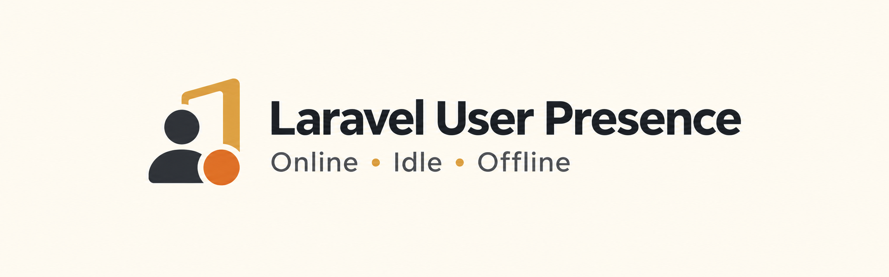

<div align="center">



[](https://packagist.org/packages/evanschleret/laravel-user-presence)
</div>

Track whether Laravel users are online, idle, or offline, and broadcast status changes to Laravel Echo.

## Requirements

- Laravel 12 or 13
- PHP 8.2 or later (Laravel 13 requires PHP 8.3 or later)
- An Eloquent user model with a nullable `last_seen_at` timestamp

## Installation

```bash
composer require evanschleret/laravel-user-presence
```

The package migrations support the default `users` table, including upgrading the legacy `last_activity_at` column and adding the broadcast status marker:

```bash
php artisan vendor:publish --provider="EvanSchleret\LaravelUserPresence\Providers\LaravelUserPresenceServiceProvider" --tag=migrations
php artisan migrate
```

For a custom user table, add nullable `last_seen_at` and `presence_broadcast_status` columns and index them together. Publish the config only when you need to change the defaults.

## Usage

Add the trait to your authenticatable model:

```php
use EvanSchleret\LaravelUserPresence\Traits\HasUserPresence;

class User extends Authenticatable
{
    use HasUserPresence;
}
```

Append the middleware to authenticated routes in `bootstrap/app.php`:

```php
use EvanSchleret\LaravelUserPresence\Middleware\UpdateLastSeen;
use Illuminate\Foundation\Configuration\Middleware;

->withMiddleware(function (Middleware $middleware): void {
    $middleware->web(append: [UpdateLastSeen::class]);
    $middleware->api(append: [UpdateLastSeen::class]);
})
```

The model exposes `$user->is_online`, `$user->is_idle`, `$user->is_offline`, `$user->last_seen_ago`, and `$user->presence_status`.

Defaults are five minutes online and ten minutes idle. Customize `online_threshold`, `idle_threshold`, `guard`, `model`, or `channel_authorizer` in `config/user-presence.php` as needed.

## Broadcasting and scheduling

Install and configure Laravel broadcasting, then listen on the user's private channel:

```ts
Echo.private(`user-presence.${userId}`)
  .listen('.user.went.online', (event) => updatePresence(event.user_id, event.status))
  .listen('.user.went.idle', (event) => updatePresence(event.user_id, event.status))
  .listen('.user.went.offline', (event) => updatePresence(event.user_id, event.status))
```

By default, a user can listen only to their own channel. Configure `channel_authorizer` to apply your application's access rules when users need to see other users' presence. Broadcasts use Laravel's queue when an asynchronous queue connection is configured.

Register the transition command in `routes/console.php`:

```php
use Illuminate\Support\Facades\Schedule;

Schedule::command('user-presence:update-statuses')->everyMinute()->withoutOverlapping();
```

Laravel's scheduler must run every minute, for example with `php artisan schedule:run` from the server cron. See the [Laravel scheduling documentation](https://laravel.com/docs/13.x/scheduling).

## Support

This package supports Laravel 12 and 13. See [CONTRIBUTING.md](CONTRIBUTING.md) to contribute and [SECURITY.md](SECURITY.md) to report a vulnerability privately.

## License

Laravel User Presence is open-source software licensed under the [MIT license](LICENSE.md).
